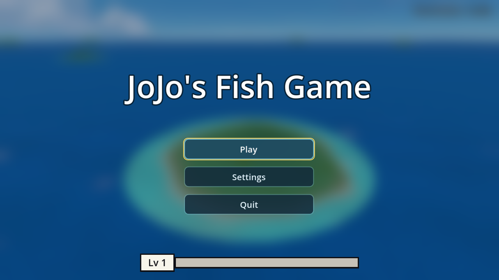
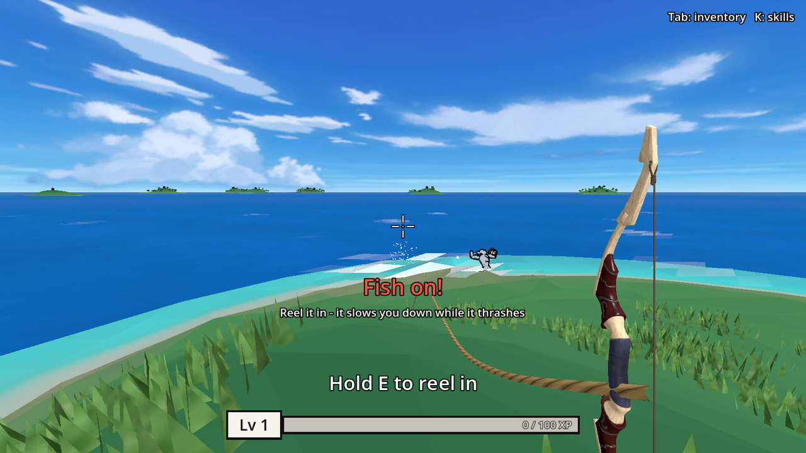
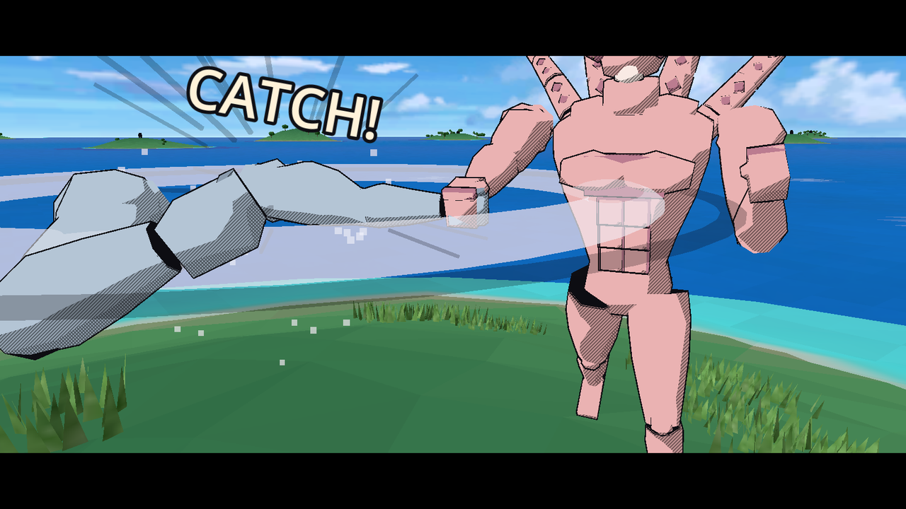
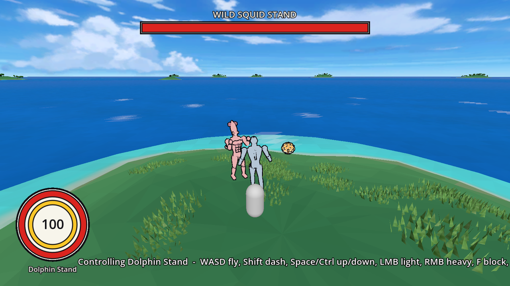
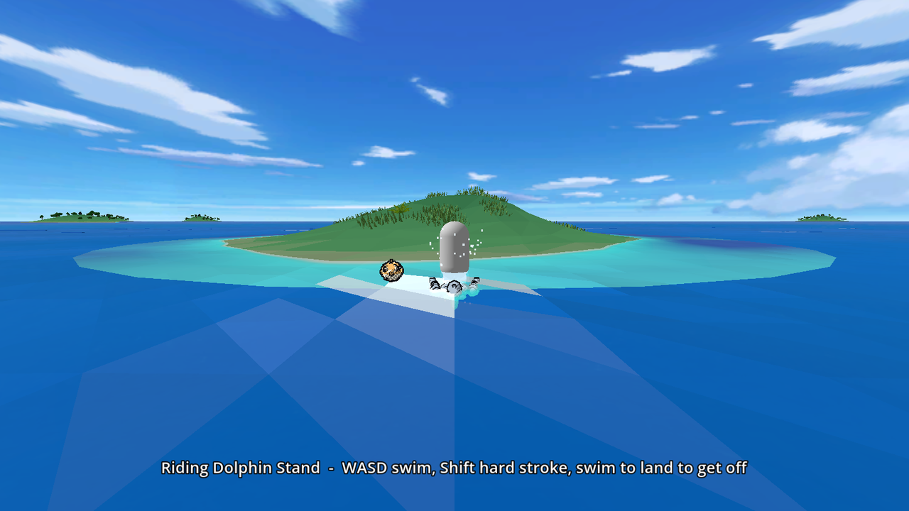
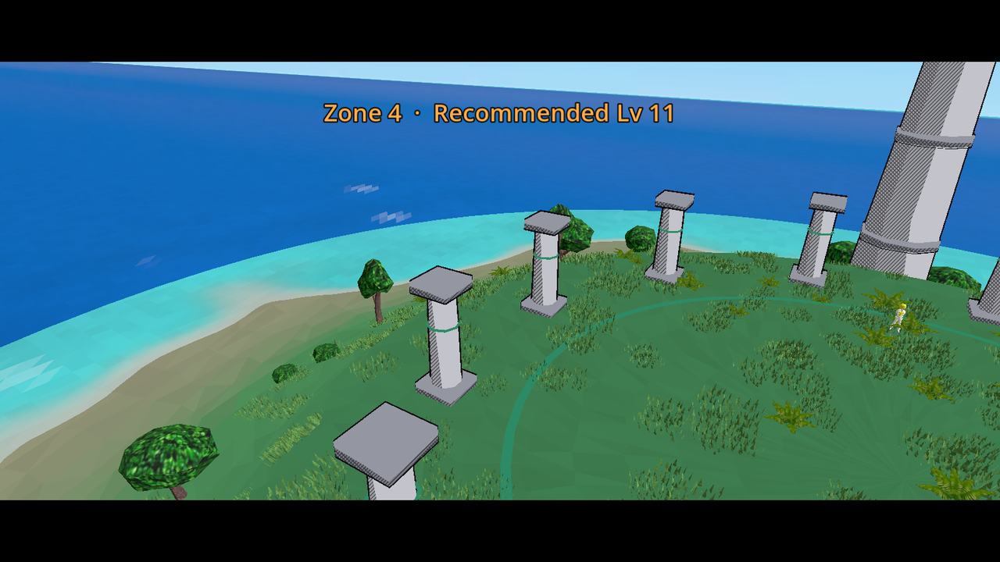
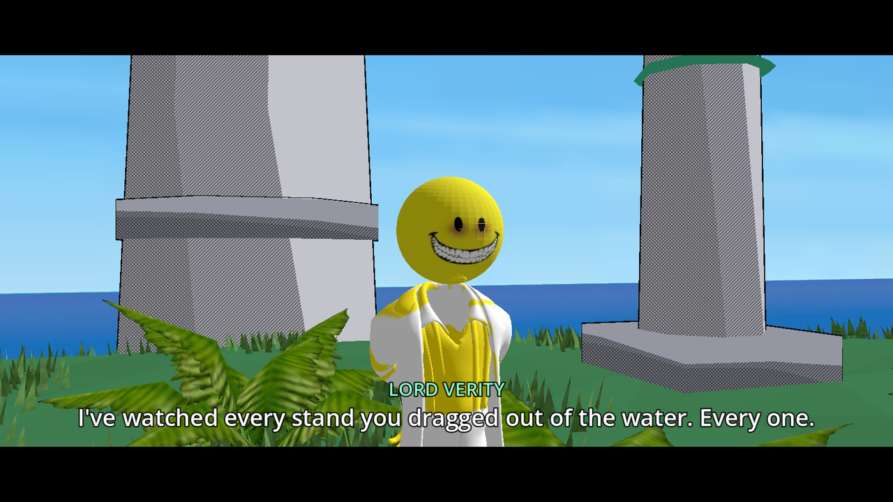

# JoJo's Fish Game

A 3D fishing and action game made in Godot 4.7. You wake up on an island with a bow and a talkative
pufferfish. Fire the bow into the sea and something bites. What you reel in are **stands**: creatures
you can summon, control and fight with. Your first is the Dolphin Stand, which you also ride to swim
between islands. Further out the catches get tougher (Anchovy schools, Squid, Lobster, and the rare
Jellyfish), and every stand has a skill tree to spend points on. At the far island, Lord Verity waits
with his Mantis Shrimp Stand, which can stop time.

## Screenshots

| | |
|---|---|
|  |  |
|  |  |
|  |  |

## Controls

| Action | Key |
|---|---|
| Move / swim | W A S D |
| Look / aim | Mouse |
| Jump | Space |
| Sprint (hard stroke when swimming) | Shift |
| Descend | Ctrl |
| Fire bow / light attack | Left mouse |
| Heavy attack | Right mouse |
| Reel in / interact | E |
| Summon or send back your stand | Q |
| Stand special move | R |
| Stand ultimate | T |
| Block / challenge | F |
| Inventory | Tab |
| Skill trees | K |
| Skip cutscene | Space |
| Pause | Esc |

## How to run

**Play the build (Windows 64-bit):** download `JoJosFishGame-v1.0-windows.zip` from the
[Releases](../../releases) page, unzip it anywhere, and run `JoJosFishGame.exe`. Keep the `.pck` file
next to the `.exe`. The game uses Direct3D 12, so it needs a reasonably recent GPU driver.

**Run from source:** install [Godot 4.7](https://godotengine.org/download) (standard build, not .NET),
clone this repo, open `project.godot` in the editor, and press **F5**. The first open takes a while
while Godot imports the assets.

The sky model isn't in this repo, because its license doesn't allow sharing the raw files. Before
opening the project, download
["Skybox Skydays 3"](https://sketchfab.com/3d-models/skybox-skydays-3-ec111b6006a14bfb91dee33a4646e80b)
from Sketchfab (free account, glTF format) and unzip it into `assets/Enviornments/skybox_skydays_3/`,
so that folder has `scene.gltf`, `scene.bin` and `textures/`. Without it the game still runs, just
with no sky.

When run from the editor (debug builds only) there are a few test keys: **F1** adds one of every
stand to the inventory, **F2** floats a target dummy in front of you (Shift+F2 clears them, Ctrl+F2
toggles whether they punch back), **F3** gives 5 skill points and **F4** refunds every skill tree.
They're left out of the exported game.

Progress (story flags, skill points) is saved to Godot's user data folder,
`%APPDATA%\Godot\app_userdata\JoJo's Fish game\` on Windows.

## Credits

Made by **beanv**: code, design, and all audio (the pufferfish's voice lines and sound effects).

Third-party 3D models, all from Sketchfab:

- **Villain (Lord Verity):** This work is based on
  ["Lord Verity RIG"](https://sketchfab.com/3d-models/lord-verity-rig-1116a6c0018c4d0c9623a43fa4045cd8)
  by [CheaterPMCPL](https://sketchfab.com/kamilborowiec066), licensed under
  [CC-BY-4.0](http://creativecommons.org/licenses/by/4.0/).
- **Bow:** This work is based on
  ["Fantasy bow"](https://sketchfab.com/3d-models/fantasy-bow-0acd23c8fb484fb9b87a914eceaf4e99)
  by [aiva](https://sketchfab.com/aiva), licensed under
  [CC-BY-4.0](http://creativecommons.org/licenses/by/4.0/).
- **Arrow:** This work is based on
  ["Stand Arrow"](https://sketchfab.com/3d-models/stand-arrow-282d0888d586437795d471ee6c7f7bdd)
  by [Retro5865](https://sketchfab.com/Retro5865), licensed under
  [CC-BY-4.0](http://creativecommons.org/licenses/by/4.0/).
- **Island plants and rocks:** This work is based on
  ["Nature Pack Ps1 - Half Life style"](https://sketchfab.com/3d-models/nature-pack-ps1-half-life-style-693e902ea4ec40aeb12a7f92bdaf2a8d)
  by [EREMA_GEP](https://sketchfab.com/EREMA_GEP), licensed under
  [CC-BY-4.0](http://creativecommons.org/licenses/by/4.0/).
- **Sky:** ["Skybox Skydays 3"](https://sketchfab.com/3d-models/skybox-skydays-3-ec111b6006a14bfb91dee33a4646e80b)
  by [JABAMI Production](https://sketchfab.com/JabamiProduction), used under the
  [Sketchfab Standard license](https://sketchfab.com/licenses).

Each model's folder under `assets/` keeps its original `license.txt`.

Built with the [Godot Engine](https://godotengine.org) (MIT license).

## License

The game's own code, design and audio are © beanv, all rights reserved. The third-party models above
stay under their own licenses.
